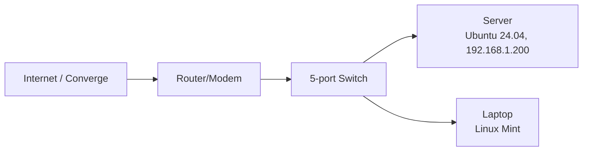

# HomeLab

A documented home server I'm building to practice Linux system administration. Every phase ends with a runbook and config files in this repo, so each claim here can be checked.

**Goal:** build the skills and evidence for an entry-level remote Linux sysadmin role.

## Hardware

| Item | Detail |
|------|--------|
| Server | Repurposed desktop, AMD A6-7400K, 16 GB RAM, SSD |
| OS | Ubuntu Server 24.04.5 LTS (headless) |
| Admin machine | Laptop running Linux Mint |
| Power | Server is powered on only during lab sessions; TLP installed and CPU governor set to `ondemand` to reduce idle and load power use |

## Network diagram



## Baseline hardening

Full details and verification commands are in [docs/baseline.md](docs/baseline.md).

- **SSH keys only, password login disabled.** Passwords can be brute-forced; keys can't be guessed the same way.
- **Root login over SSH disabled.** Admin work is done as a normal user with `sudo`, which leaves an audit trail.
- **UFW firewall, default deny incoming.** Only SSH (22/tcp) is allowed in, which keeps the attack surface small.
- **Unattended security upgrades enabled.** Patches apply without relying on me to remember.
- **Fixed IP (192.168.1.200).** SSH, and later web services, always find the server at the same address.
- **KVM acceleration confirmed (`kvm-ok`).** The server can run VMs later, for testing and for the Ansible rebuild test.

## Roadmap progress

- [x] Phase 1: Hardware and baseline
- [X] Phase 2: Nginx web server
- [X] Phase 3: LEMP stack
- [x] Phase 4: Bash scripting and backups
- [ ] Phase 5: Git and Ansible
- [ ] Phase 6: Docker and Docker Compose
- [ ] Phase 7: Monitoring
- [ ] Phase 8: Pi-hole
- [ ] Phase 9: Remote access and security
- [ ] Phase 10: Public deployment with HTTPS

## Progress log

```
2026-10-18  Phase 1 complete. Ubuntu Server 24.04 headless, SSH keys only, ufw and unattended-upgrades on. See docs/baseline.md.
2026-10-19  Phase 2 complete. Nginx site served on the LAN, logs and config errors practiced. See docs/nginx.md.
2026-10-21  Phase 3 complete. LEMP stack with WordPress running at wp.lab.local. See docs/lemp.md.
2026-10-22  Phase 4 complete. Bash backup script (DB dump + web root, SHA-256 checksums, 7-day retention, logging, non-zero exit on failure), run from cron. Restore tested side by side and via a disaster drill. See docs/backups.md.
```
