# Docker and Docker Compose

Phase 6 of my homelab. I installed Docker Engine from Docker's official apt repository, ran Uptime Kuma with Docker Compose behind my existing Nginx as a reverse proxy, and tested volumes, networks, restart policies, and volume backup and restore.

Everything below was done on the lab server and verified. Screenshots are in [`img/`](img/).

## Environment

| Item | Value |
|------|-------|
| Host | Ubuntu Server 24.04.5 LTS, headless, kernel 6.8.0-147 |
| Docker Engine | 29.9.2 (from `download.docker.com`, not Ubuntu's `docker.io`) |
| Docker Compose | v5.7.0 (the `docker compose` plugin) |
| Firewall | ufw, default deny incoming, allows only SSH (22) and Nginx (80) |
| Container | Uptime Kuma 2.5.9 (`louislam/uptime-kuma:2`) |
| Reverse proxy | Nginx on the host, `kuma.lab.local` |

## Contents

```
docker/
├── README.md                 # this file
├── img/                      # screenshots referenced below
├── uptime-kuma/
│   └── compose.yml           # the Uptime Kuma stack (commented)
└── scratch-lab/
    └── compose.yml           # throwaway stack used to test volumes and networks (commented)

configs/nginx/kuma            # Nginx server block that proxies to the container
```

## Architecture

```
 Laptop browser
      │  http://kuma.lab.local        (hosts-file entry on the laptop)
      ▼
 ┌─────────────────────── lab server ───────────────────────┐
 │  ufw: only 22 and 80 allowed in                           │
 │                                                           │
 │  Nginx (host) :80  ──proxy_pass──►  127.0.0.1:3001        │
 │                                          │                │
 │                          ┌───────────────┘  loopback only │
 │                          ▼                                │
 │            container: uptime-kuma  (mem_limit 512m)       │
 │            network:   uptime-kuma_default                 │
 │            volume:    uptime-kuma_kuma-data → /app/data   │
 └───────────────────────────────────────────────────────────┘
```

The container is published on `127.0.0.1` only. Nginx is the single front door.

---

## 1. Installing Docker Engine from the official repository

Steps: confirm nothing conflicting was installed, add Docker's GPG key and apt source (`Suites: noble`), install `docker-ce`, `docker-ce-cli`, `containerd.io`, `docker-buildx-plugin`, and `docker-compose-plugin`, then verify.

Checks I ran before and after:

- Pre-flight: `ss -tulpn` (SSH, Nginx, MariaDB on loopback, cloudflared), `df -h /` (33 GB free), `ufw status verbose`, and `dpkg -l | grep docker` (nothing installed).
- Service is `active (running)` and `enabled` at boot.
- `hello-world` ran successfully.
- My user was added to the `docker` group.

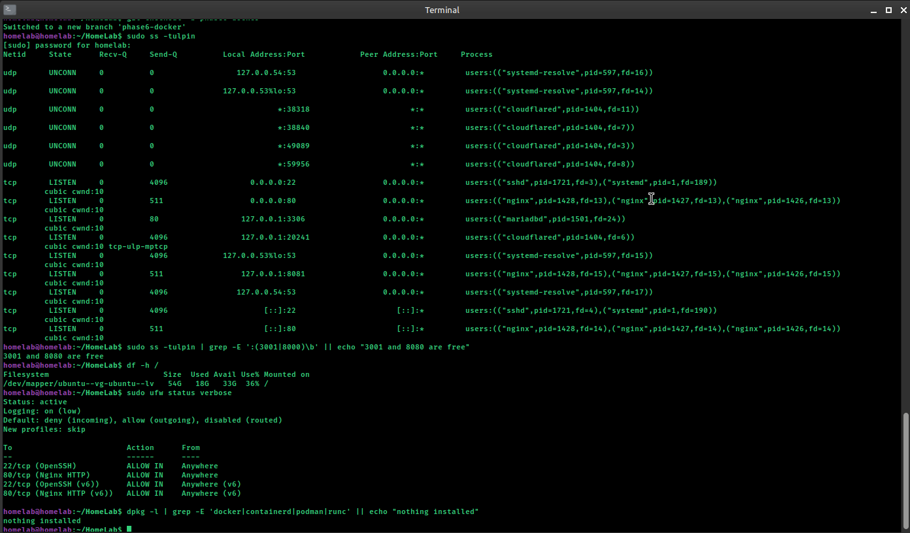
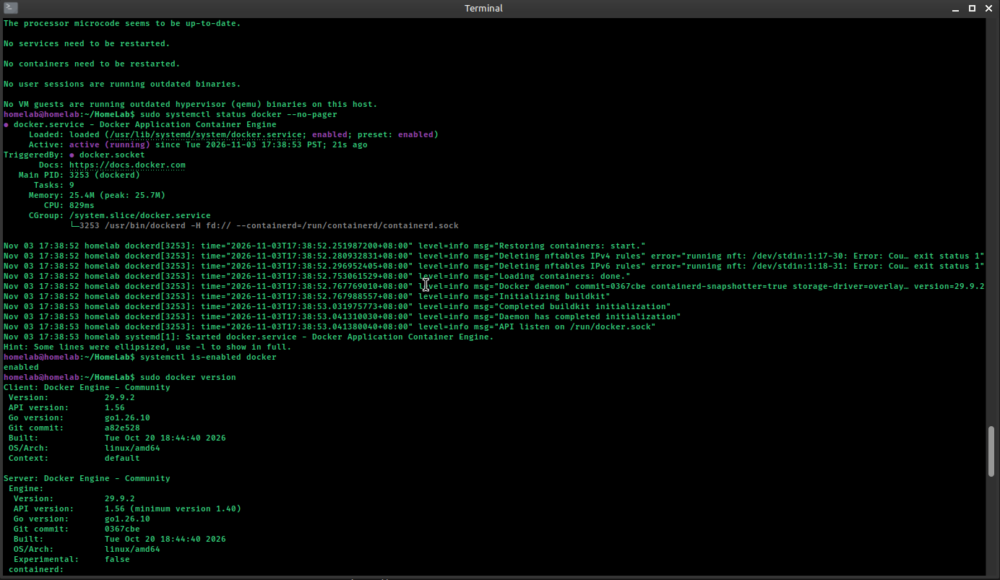
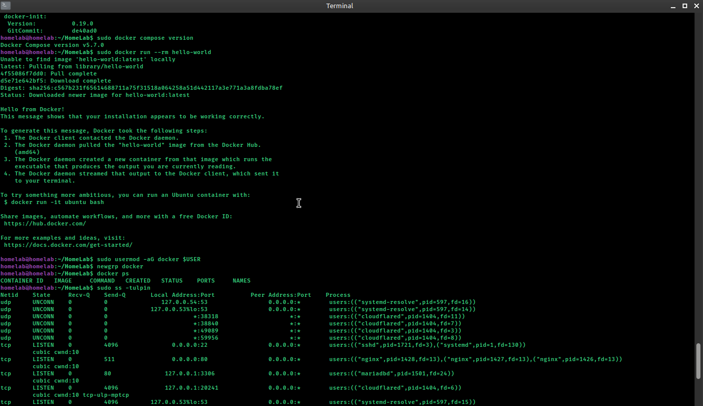

**Note on the `docker` group:** membership is effectively root on the host, because a container can mount the host filesystem. That is acceptable on a single-user lab. On a shared server I would not hand it out casually.

---

## 2. Finding: Docker published ports bypass ufw

This was the most useful lesson of the phase.

**What I did:** ran a throwaway Nginx container with `-p 8080:80` while ufw had no rule for port 8080 (its rules list only OpenSSH and Nginx HTTP).

**What happened:** `docker ps` showed `0.0.0.0:8080->80/tcp`, and from my laptop browser `http://192.168.1.200:8080` loaded the Nginx welcome page. ufw said the port was not allowed, but it was reachable anyway.

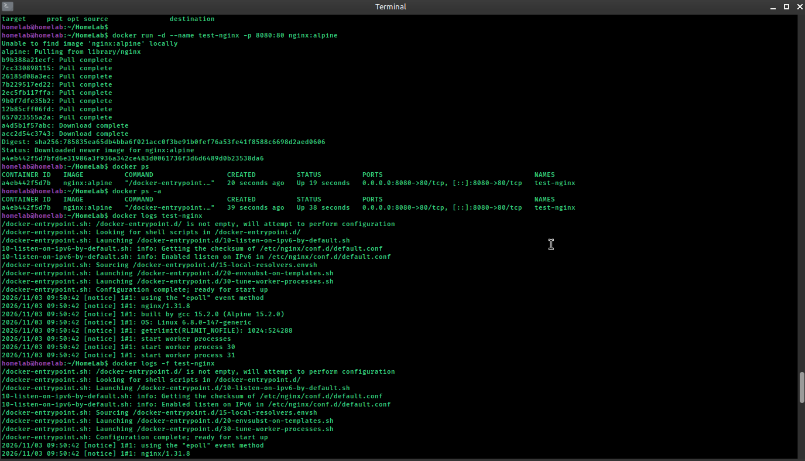
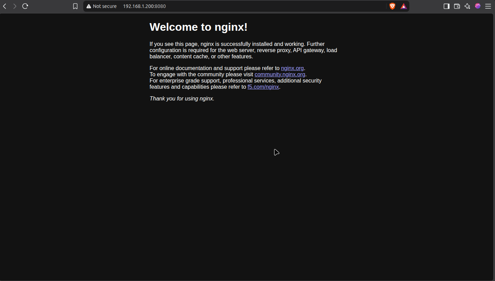

**Why:** Docker writes its own firewall rules for published ports (NAT rules are visible with `sudo iptables -t nat -L -n`). The forwarded traffic does not pass through the ufw rules that guard the host's own services, so ufw is not the control that protects a published container port.

**Fix:** publish only on the loopback address, `-p 127.0.0.1:8080:80`. Result:

- `curl http://127.0.0.1:8080` returned `200 OK`.
- `curl http://192.168.1.200:8080` (the server's LAN address) was refused.

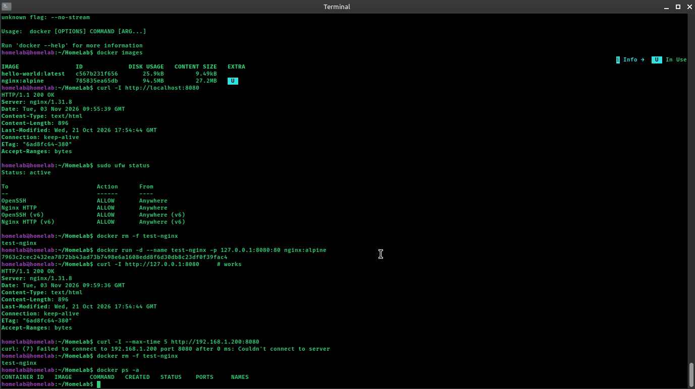

**Rule I followed for the rest of the phase:** publish container ports as `127.0.0.1:HOST:CONTAINER` unless I deliberately want LAN exposure, and let Nginx be the controlled entry point.

*Not done:* filtering published ports with rules in Docker's `DOCKER-USER` chain. Loopback binding was enough for this lab.

---

## 3. Uptime Kuma with Docker Compose

File: [`uptime-kuma/compose.yml`](uptime-kuma/compose.yml)

| Setting | Why |
|---------|-----|
| `image: louislam/uptime-kuma:2` | Pins the major version. The `latest` tag still points at the old v1 line, so I avoided it. |
| `restart: unless-stopped` | Comes back after crashes and reboots, but stays down if I stop it on purpose. |
| `ports: "127.0.0.1:3001:3001"` | Loopback only, so ufw cannot be bypassed (section 2). |
| `volumes: kuma-data:/app/data` | Named volume holds monitors, settings, and history. |
| `mem_limit: 512m` | Protects the lab server's RAM. `docker compose config` shows it resolved to 536870912 bytes. |

`docker compose config` validated the file, `docker compose up -d` pulled the image and created the network and volume, and `docker compose ps` showed the container `healthy` with the port bound to `127.0.0.1:3001`.

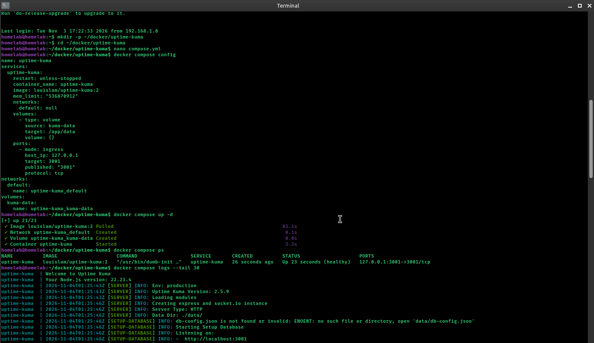

**First-run security:** on a brand-new volume, the first visitor to the web UI creates the admin account. Because the port was loopback-only, nobody else could reach it. I created the admin account through the proxy as soon as it was working.

---

## 4. Nginx reverse proxy in front of the container

File: [`../configs/nginx/kuma`](../configs/nginx/kuma)

Key points:

- `proxy_pass http://127.0.0.1:3001;` forwards to the container.
- `Upgrade` and `Connection "upgrade"` headers are included because Uptime Kuma uses WebSockets.
- `Host`, `X-Real-IP`, `X-Forwarded-For`, and `X-Forwarded-Proto` are passed through.
- Separate access and error logs: `kuma.access.log` and `kuma.error.log`.
- The laptop reaches it by a hosts-file entry, `192.168.1.200 kuma.lab.local`.

Verification: `curl -I http://kuma.lab.local` returned the application's redirect (to its setup page on first run, `/dashboard` after setup), and the Nginx access log shows the browser's `socket.io` requests passing through the proxy successfully.

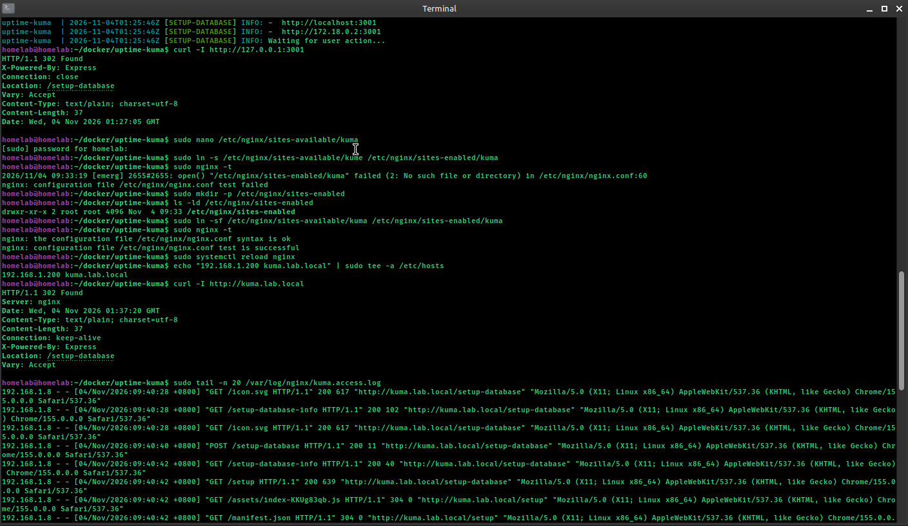
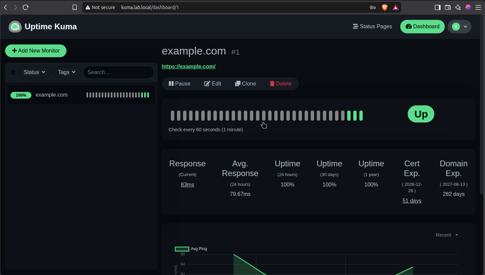

### Incident 1: `nginx -t` failed after enabling the site

`sudo nginx -t` reported that it could not open `/etc/nginx/sites-enabled/kuma` (`nginx.conf:60`). The symlink was dangling, most likely because I created it before the file in `sites-available/` existed. Recreating it with `sudo ln -sf /etc/nginx/sites-available/kuma /etc/nginx/sites-enabled/kuma` fixed it, `nginx -t` passed, and I reloaded.

Lesson: always run `nginx -t` before `systemctl reload nginx`. It caught the problem before it affected anything.

### Incident 2 (deliberate): 502 Bad Gateway

I changed `proxy_pass` to port 3002, where nothing was listening. `nginx -t` still passed and the reload succeeded, but the browser showed **502 Bad Gateway**. I then restored the correct port, re-ran `nginx -t`, and reloaded.

Lesson: `nginx -t` validates syntax, not whether the upstream is alive. When the proxy returns 502, check the container (`docker compose ps`, `curl http://127.0.0.1:3001`) and the Nginx error log.

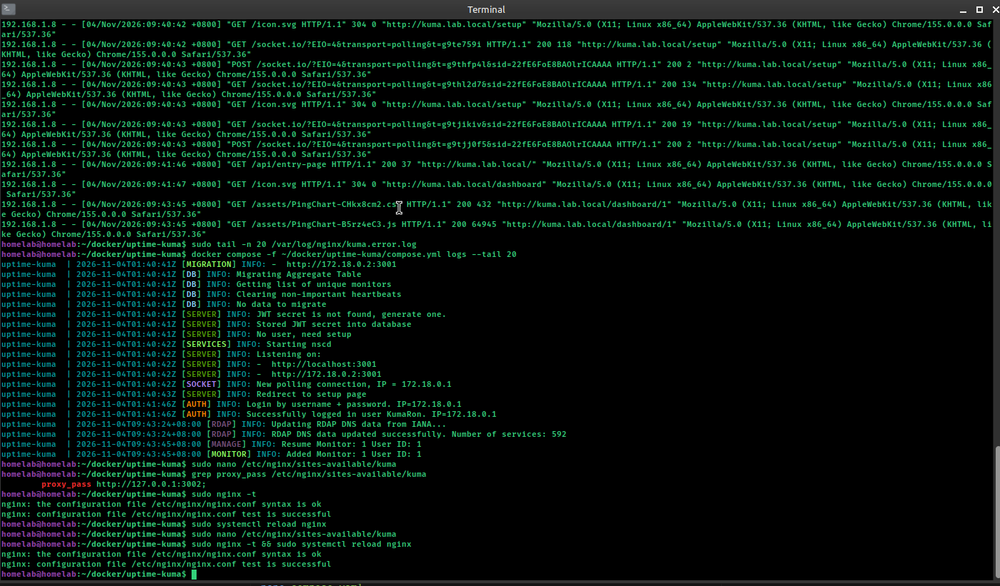
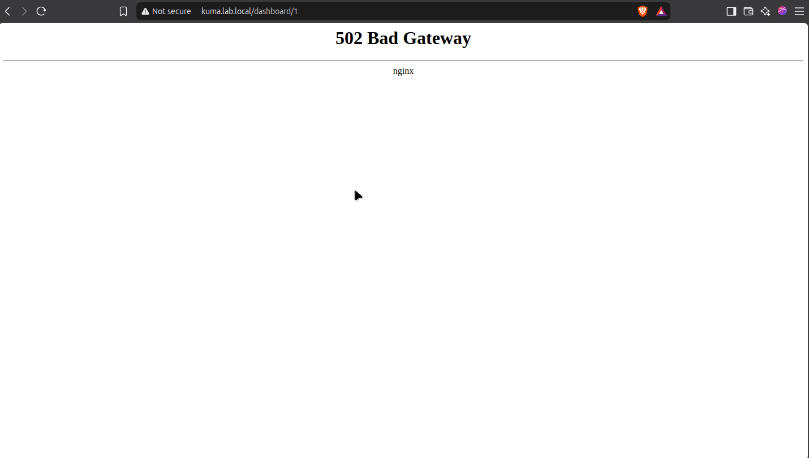

---

## 5. Volumes, networks, and restart policies

I tested these in a throwaway project so Uptime Kuma was never at risk. File: [`scratch-lab/compose.yml`](scratch-lab/compose.yml). The scratch project was removed afterwards.

### Volumes: `down` vs `down -v`

| Step | Result |
|------|--------|
| Wrote `hello.txt` into the named volume, read it from another container | `hello from the volume` |
| `docker compose down` | Containers and network removed. `docker volume ls` still listed `scratch_testdata`. |
| `docker compose up -d`, read the file again | Still there: the data survived. |
| `docker compose down -v` | `docker volume ls` showed only `uptime-kuma_kuma-data`: `scratch_testdata` was deleted. |

Takeaways:

- `docker compose down` removes containers and networks but **keeps named volumes**.
- `docker compose down -v` **deletes the volumes and their data**.
- `down` is scoped to its own project. Running it in `scratch-lab` did not touch the `uptime-kuma` container, which stayed up (see the `docker ps -a` output in the screenshot).

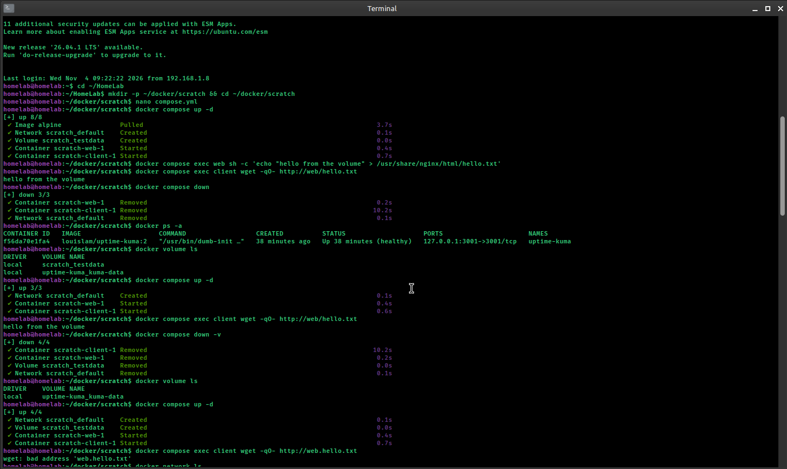

### Networks: service-name DNS

Compose created a private bridge network per project (`scratch_default` on `172.19.0.0/16`, `uptime-kuma_default` on `172.18.0.0/16`). Inside the scratch project, the `client` container reached `web` by service name (`ping web` resolved to `172.19.0.2`). Containers in different projects are on different networks and cannot reach each other unless they are explicitly connected.

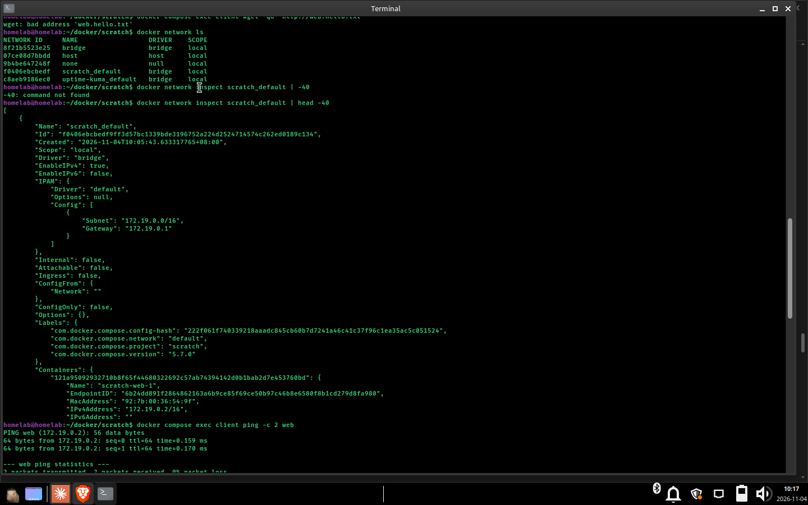

### Restart policies and a reboot test

- Confirmed the policy: `docker inspect -f '{{.HostConfig.RestartPolicy.Name}}' uptime-kuma` printed `unless-stopped`.
- `docker compose stop` left the container `Exited (0)`: with `unless-stopped`, a container I stopped on purpose is not restarted automatically.
- I started it again and rebooted the whole server. After SSH came back, without running any command, `docker ps` showed `uptime-kuma` up and `healthy`, and `kuma.lab.local` responded.

That works because two things are true: the `docker` service is enabled at boot, and the container's restart policy is `unless-stopped`. If either were missing, it would stay down.

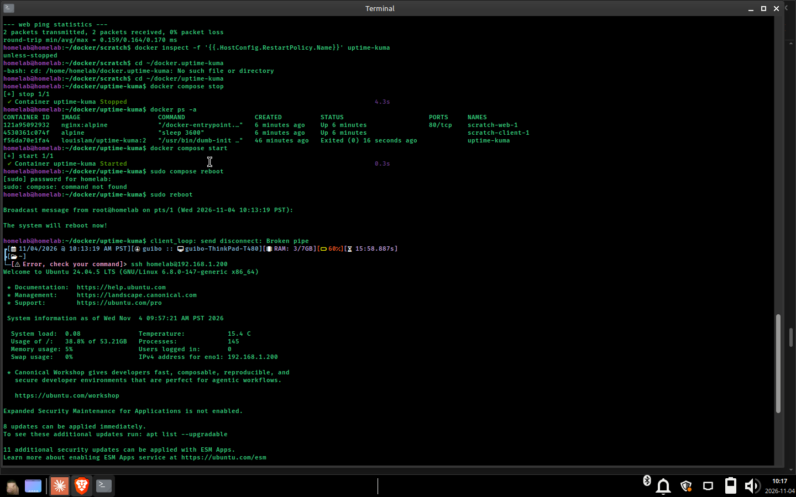
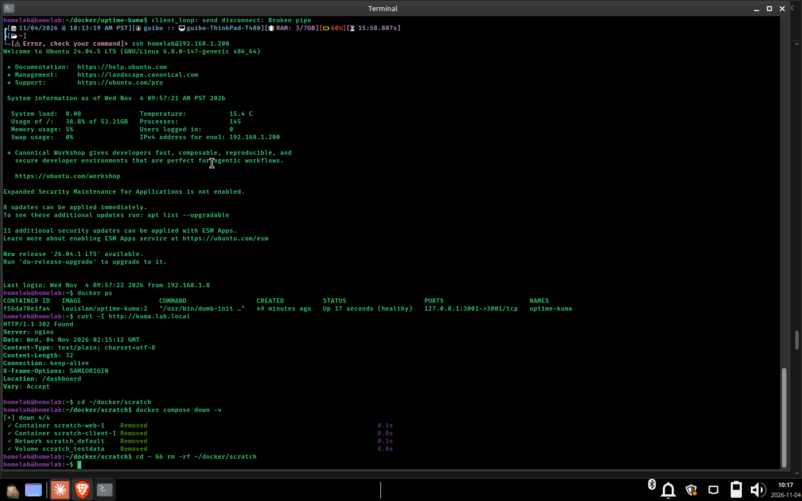

---

## 6. Backing up and restoring a Docker volume

A backup is only real once it has been restored. The volume is named `uptime-kuma_kuma-data` (the project folder name plus the volume name).

**Backup** (container stopped first so the SQLite files are not changing mid-copy):

```bash
mkdir -p ~/backups/docker
cd ~/docker/uptime-kuma
docker compose stop

docker run --rm \
  -v uptime-kuma_kuma-data:/data:ro \
  -v ~/backups/docker:/backup \
  alpine tar czf /backup/kuma-data-$(date +%F).tar.gz -C /data .

docker compose start
```

Result: `kuma-data-2026-11-04.tar.gz` (31 KB) in `~/backups/docker`.

**Restore test** into a *new* volume, never on top of live data:

```bash
docker volume create kuma-restore-test
docker run --rm \
  -v kuma-restore-test:/data \
  -v ~/backups/docker:/backup \
  alpine sh -c "tar xzf /backup/kuma-data-$(date +%F).tar.gz -C /data"
docker run --rm -v kuma-restore-test:/data alpine ls -la /data
```

The listing showed `kuma.db`, `db-config.json`, `docker-tls/`, `screenshots/`, and `upload/`. I then started a second Uptime Kuma on the restored volume (`127.0.0.1:3002`), which answered with a redirect to its dashboard. I reached it from my laptop through an SSH tunnel, logged in, and the dashboard showed the same `example.com` monitor as the original instance. Finally I removed the test container and volume.

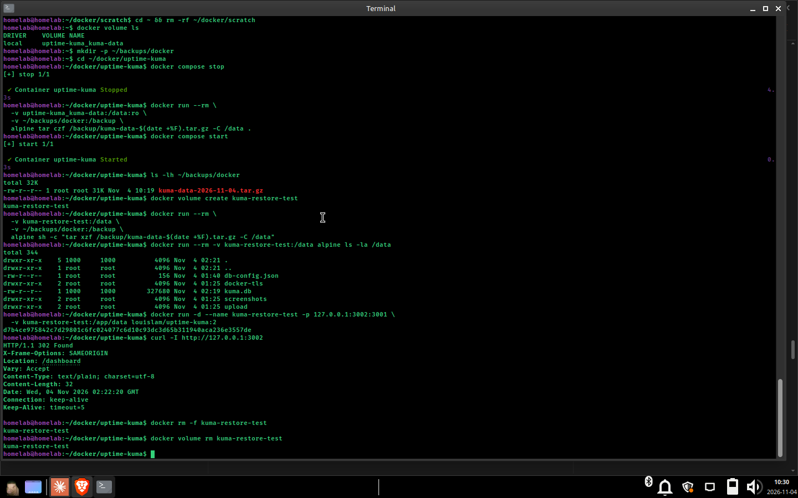
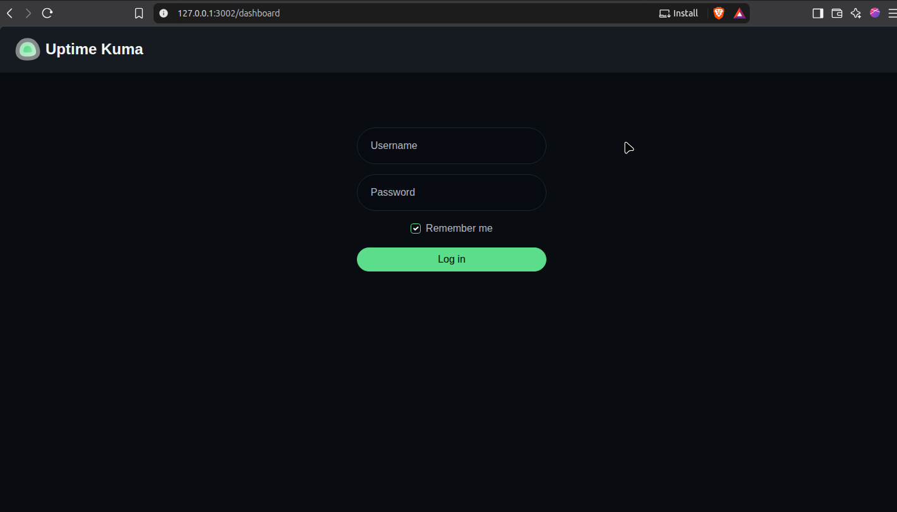
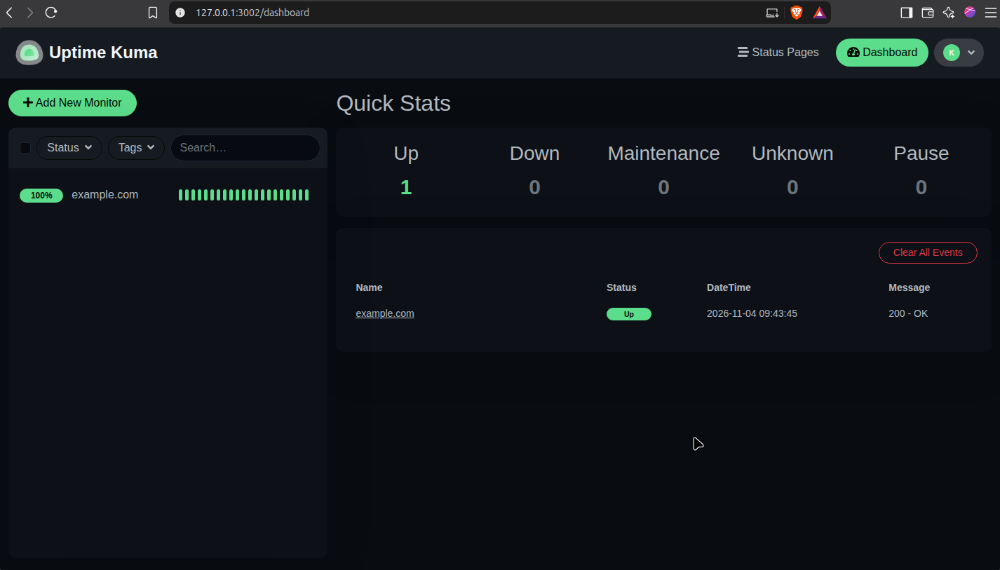

**Security note:** the backup contains the Kuma database, including the admin account's credentials. Backup archives live outside this repository and are excluded in `.gitignore`. Never commit them.

---

## 7. Housekeeping

- **Log rotation:** `/etc/docker/daemon.json` sets the `json-file` driver with `max-size: 10m` and `max-file: 3`. After restarting Docker I recreated the container (the setting only applies to new containers) and confirmed it with `docker inspect -f '{{.HostConfig.LogConfig}}' uptime-kuma`, which printed `{json-file map[max-file:3 max-size:10m]}`.
- **Disk use:** `docker system df` shows images, containers, and volumes. `docker image prune` reclaimed 0 B, which is expected: it removes only dangling images, and my images are all tagged. I avoid `docker system prune -a --volumes` because it can delete volumes.
- **Update flow:** `docker compose pull` then `docker compose up -d`. Compose only recreated the container when the image actually changed (here it reported `Running`, nothing to update). The habit that matters: back up the volume first.

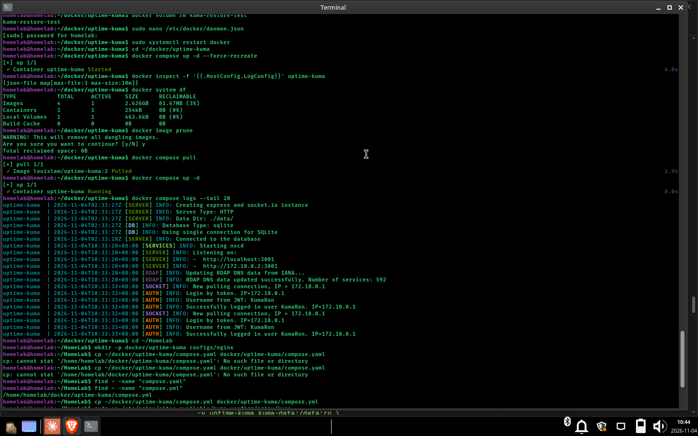

---

## 8. Operations cheat sheet

```bash
# status and logs
cd ~/docker/uptime-kuma
docker compose ps
docker compose logs --tail 50
docker stats --no-stream

# stop / start without losing data
docker compose stop
docker compose start

# apply compose changes, or update the image
docker compose up -d
docker compose pull && docker compose up -d

# validate a compose file
docker compose config

# DANGER: removes containers AND the data volumes
docker compose down -v        # do not run in uptime-kuma/ unless wiping on purpose
```

## 9. Decisions and security notes

- Official Docker apt repository, major version pinned (`:2`), never `:latest`.
- Container ports are published on `127.0.0.1` and exposed only through Nginx (section 2).
- Every service has `restart:` and a `mem_limit` on this RAM-limited lab.
- No secrets in this repository: the compose file and Nginx config contain none, the Kuma admin credentials live only inside the data volume, and backup archives are kept out of git.
- Learning experiments run in a disposable project, not in the real stack.

## 10. Not done yet, and next steps

- The Kuma instance currently has one test monitor (`example.com`). Monitoring my own site and SSH, plus a deliberately triggered alert, is Phase 7.
- The volume backup is manual. It could be turned into a script and a cron job, like the Phase 4 backups.
- Docker installation and the Kuma stack are not yet in my Ansible playbooks (Phase 5). Adding a Docker role would make this reproducible from scratch.
- HTTPS for this proxy comes with the public deployment in Phase 10.
